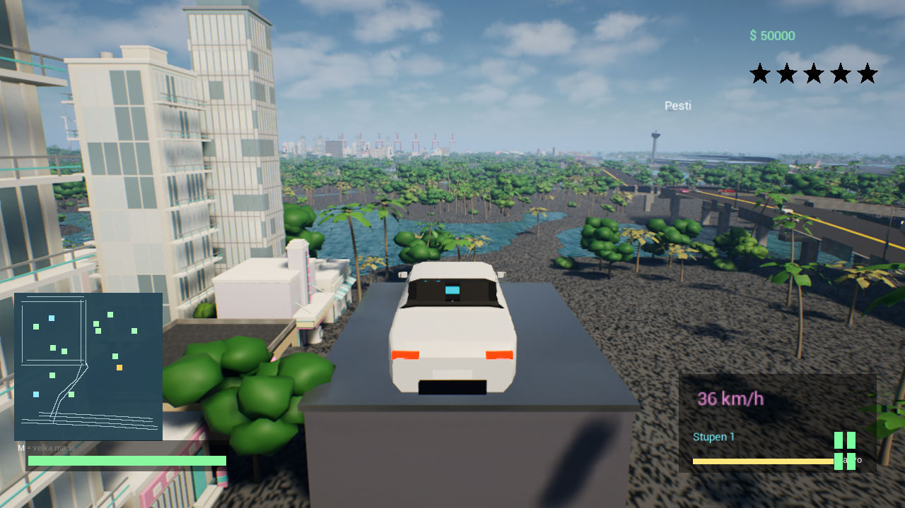
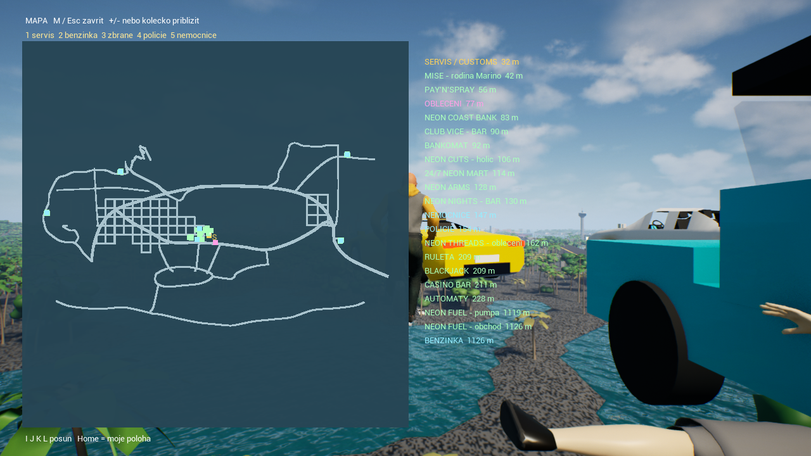
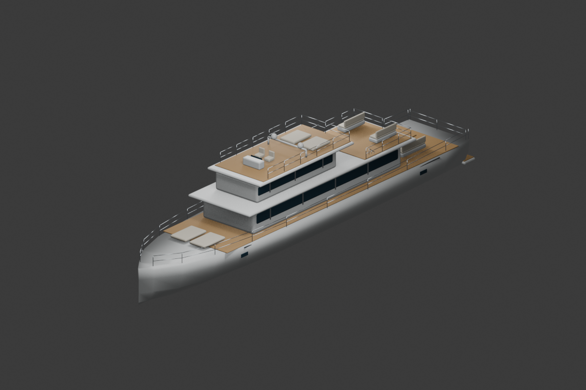

# Neon Coast

Open-world akční hra z neonového přímořského města, vyvíjená v **Unreal Engine 5** s herní logikou v C++ (plugin `NeonCoast`). Jezdíš autem, loděmi i letadly, plaveš, plníš mise s mafiánským příběhem, vykrádáš obchody a utíkáš před policií.

## Co hra umí

- **Otevřené město** s mosty, silnicemi, palmami a vodou, minimapou a velkou mapou (**M**) se seznamem podniků a vzdáleností.
- **Provoz a chodci** – auta drží pruhy, zpomalují před zatáčkami, respektují semafory a přednost; pěší hlídky a davy lidí.
- **Vozidla** – auta, lodě, ponorka, letadlo a vrtulník, nastupování a vystupování klávesou **F**, tuning v servisu Neon Coast Customs.
- **Hledanost a policie** – hvězdy, svědci, pátrání na posledním známém místě, zatčení.
- **Mise a příběh** – původní mise doplněné mafiánským příběhem (4 kapitoly, 21 úkolových kroků, 8 dialogových scén s kamerou a titulky).
- **Služby a interiéry** – obchod se zbraněmi, oblečení, holič, banka, kasino, bary, restaurace, přepadení pokladen.
- **Voda** – plavání, potápění, podvodní efekt, ponorka u skutečného dna.
- **Nabídka Esc a nastavení** – grafika, měřítko vykreslování, limit FPS, V-Sync.

  
  

*Vlevo velká mapa s podniky, vpravo upravitelný model 38m jachty (náhled z Blenderu).*

## Co je v repozitáři

| Cesta | Obsah |
|---|---|
| `Plugins/NeonCoast/Source/` | C++ herní logika (provoz, policie, mise, zbraně, vozidla, voda, HUD…) |
| `Source/` | Hlavní herní modul |
| `Content/NeonCoast/Data/` | Herní data v JSON: mise, příběh, provoz, umístění objektů, materiály, vozidla, voda |
| `SourceAssets/Marine/` | Model jachty (Blender + FBX), textury korálů a teaku, skript `build_marine_assets.py` |
| `Config/` | Konfigurace projektu |
| `CTI_ME.md` | Podrobný deník změn |

**Nejsou zde** binární herní assety (`.uasset`/`.umap`, celé stovky MB až GB), sestavená hra ani Unreal Engine. Projekt tedy nejde z tohoto repozitáře rovnou otevřít a spustit – slouží jako ukázka kódu, dat a vzhledu hry.

## Ovládání (výběr)

`F` nastoupit/vystoupit · `E` použít/vstoupit · `M` mapa · `F8` další hlavní zakázka · `Esc` nabídka · `W/S/A/D` pohyb a jízda · `Space` / `Ctrl` stoupat/klesat (voda, letadla)

## Stav

Úpravy byly ověřeny **sestavením** (překlad a balení proběhly úspěšně), ale podle zápisů v `CTI_ME.md` nebyla každá změna odzkoušena hraním. Některé části jsou záměrně zjednodušené (procedurální plavecká póza, kamerové scény místo natočených animací, náhradní materiály u ztracených originálů).
